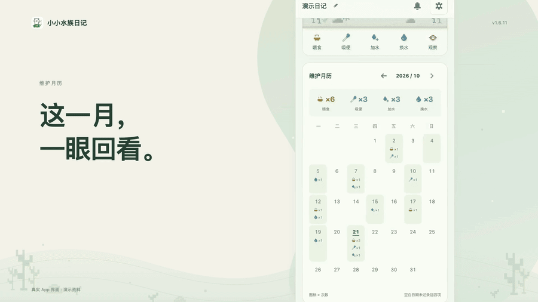
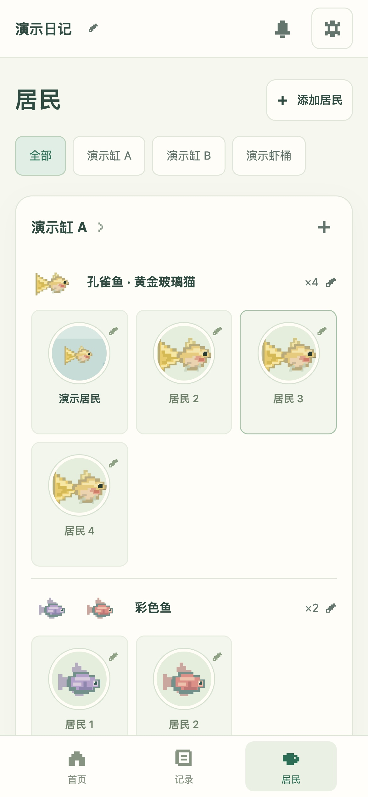
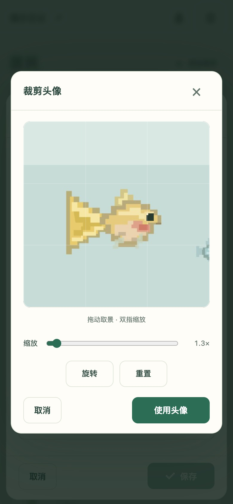
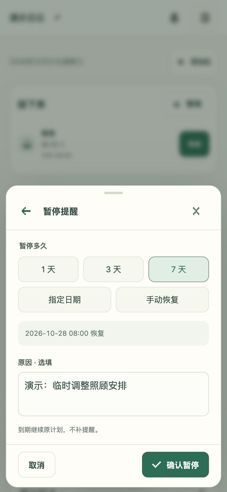
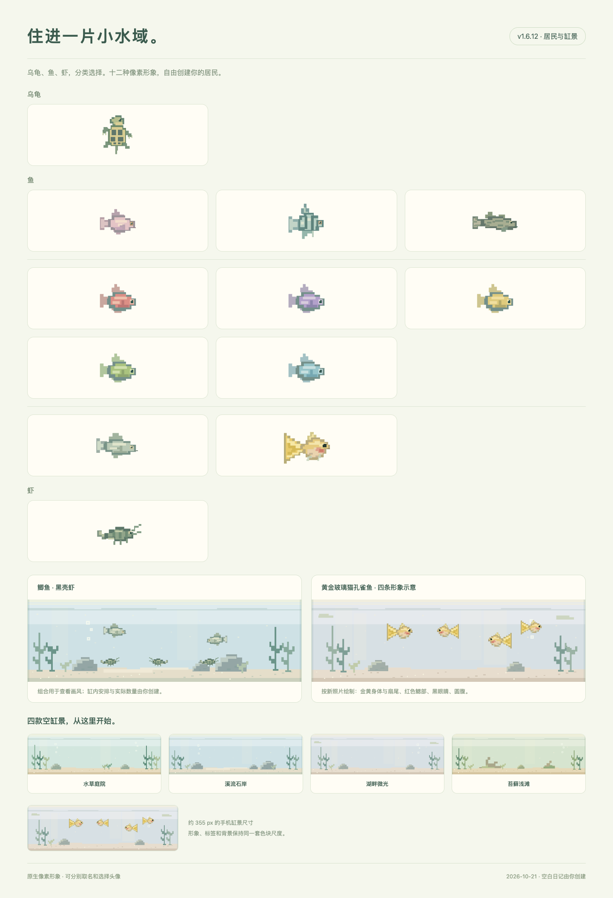

<h1 align="center">小小水族日记</h1>
<p align="center">照顾好，也记录好。</p>

[](https://jiangyt1412.github.io/little-aqua-diary/intro.html#demo)

<p align="center"><a href="https://jiangyt1412.github.io/little-aqua-diary/"><strong>打开日记 ↗</strong></a>　 ·　 <a href="https://jiangyt1412.github.io/little-aqua-diary/intro.html">项目介绍</a>　 ·　 <a href="https://jiangyt1412.github.io/little-aqua-diary/intro.html#demo">产品短片 ▶</a></p>
<p align="center"><strong>Version 1.6.12</strong> · 2026-10-21</p>

## 给每一缸，留一点日常。

[](https://jiangyt1412.github.io/little-aqua-diary/intro.html#demo)

喂食、吸便、加水记下此刻，换水记录水量。居民可以取名、选形象、裁剪照片；记录按缸排列，在时间轴与月历里回看。

[观看 24 秒产品短片 · MP4](dist/media/demo-v1.6.12.mp4)

<details>
<summary><strong>实际界面</strong></summary>

<table>
<tr><td align="center"><br>首页</td><td align="center"><br>居民</td></tr>
<tr><td align="center"><br>记录</td><td align="center"><br>维护月历</td></tr>
<tr><td align="center"><br>头像取景</td><td align="center"><br>暂停与恢复</td></tr>
</table>



</details>

画面使用隔离演示资料。名字和记录为示例，照片附件为原生像素插画。短片的真实界面由高分辨率页面帧录制，镜头运动用于展示；没有实体手机外壳或系统键盘。首次打开日记为空白状态。

## 本次更新 · v1.6.12

- 收紧宣传页文字与双屏之间的间距，文字栏按实际内容占位，双屏靠近并适度放大。
- 保留手机纵向布局，更新宣传封面；没有增加填充文案。
- 月历版短片、字幕和动图沿用已确认的 v1.6.11 原文件，片内版本仍为 v1.6.11；本次没有重新编码影片。App 操作及数据格式不变。

[所有版本的更新](CHANGELOG.md) · [版本号怎样区分](docs/VERSIONS.md) · [验收与设备范围](验收记录.md)

## 使用与备份

Safari 打开 [在线日记](https://jiangyt1412.github.io/little-aqua-diary/)，选择「共享 → 添加到主屏幕」。首次联网并完成缓存后可离线记录。[Apple 官方说明](https://support.apple.com/zh-cn/guide/iphone/iphea86e5236/ios)

日记与照片保存在当前浏览器，没有云同步。换设备、换网址或清除网站数据前，导出「备份（含照片）」；在新入口恢复备份会替换当前资料。旧网址的数据不会自动迁移。

提醒在 App 内显示，也可导出日历文件；App 中暂停或修改任务不会同步修改已经导入的日历。移动端验证采用模拟视口，实体 iPhone 的键盘、下载、照片与日历导入仍需实际设备复核。

更新入口为「管理与备份 → 检查更新」，查看更新内容后安装，保持联网直到自动重开。无需卸载或清除网站资料。

## 本地运行

无前端安装依赖，需要 Python 3。

```sh
python3 -m http.server 4173 --bind 127.0.0.1 --directory dist # 打开 http://127.0.0.1:4173/
```

```sh
npm test # 验证数据、联动、提醒、视口与版本规则
npm run check:release # 检查版本、说明、素材和部署资源
```

[完整使用说明](docs/USAGE.md) · [GitHub 部署](docs/DEPLOYMENT.md) · [维护约定](AGENTS.md)
