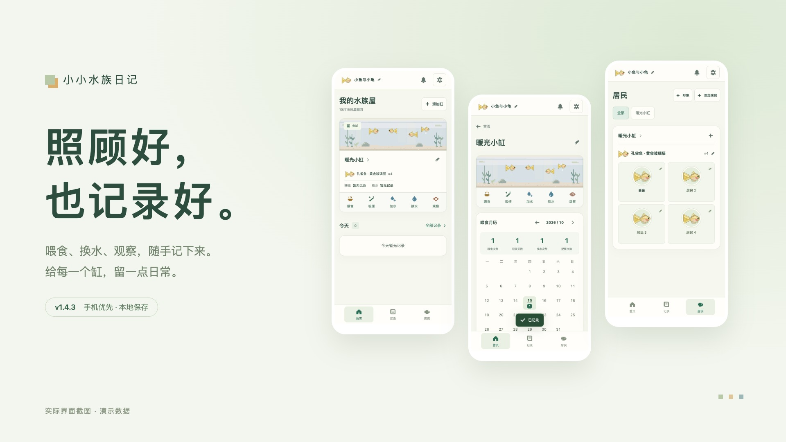
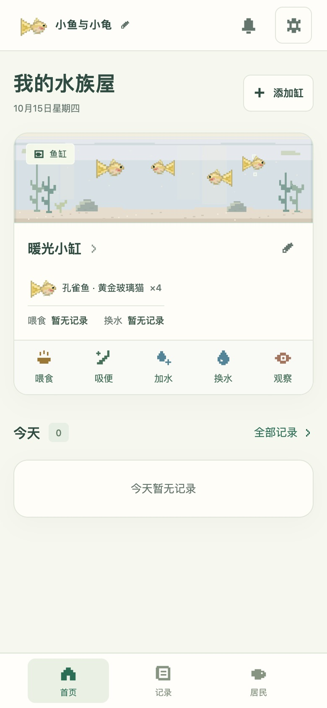
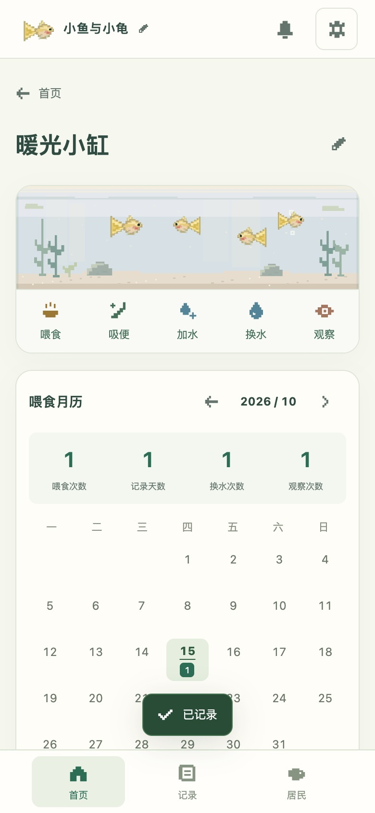
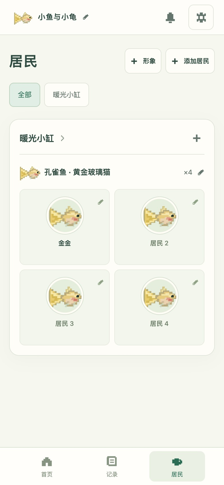
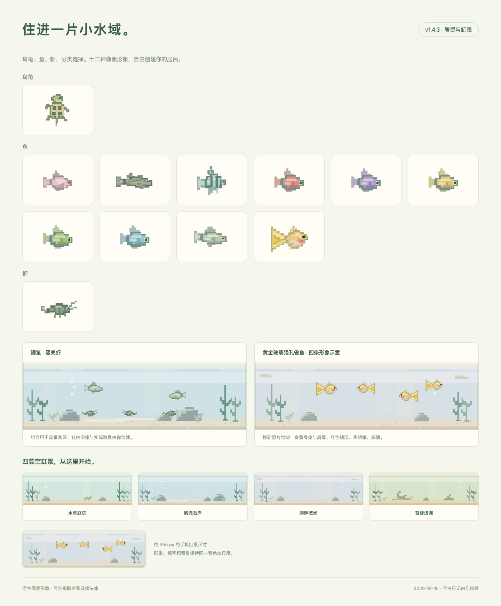

<p align="center"></p>

<h1 align="center">小小水族日记</h1>

<p align="center">照顾好，也记录好。<br>给家里的鱼缸、龟缸和虾桶，一本随手可记的日记。</p>

<p align="center"><strong>Version 1.4.3</strong> · 2026-10-15<br><a href="https://jiangyt1412.github.io/little-aqua-diary/">打开日记</a> · <a href="https://jiangyt1412.github.io/little-aqua-diary/intro.html">项目简介</a> · <a href="CHANGELOG.md">更新记录</a></p>



## 每天常用的，放在手边

- **随手记时间**：喂食、吸便、加水一点就记；换水可填升数或比例。
- **看看这个缸**：点进鱼缸，查看喂食月历与维护记录。
- **认识每一位居民**：改物种和数量，给非黑壳虾个体取名字、上传头像。
- **新增自动联动**：新增生物后，缸内名单与数量一起更新。
- **照片留住观察**：观察记录支持照片，历史支持关键词搜索。
- **App 内检查更新**：查看当前和新版版本、阅读更新内容，准备完成后直接更新。
- **备份带走日记**：导出包含记录、居民和照片的 JSON，换网址或手机时恢复。

主界面只有首页、记录、居民三个入口。缸景在创建与编辑缸时选择；提醒收在右上角，保持三个主入口。

## 看一段实际操作

[▶ 在线播放 v1.4.3 演示](https://jiangyt1412.github.io/little-aqua-diary/intro.html#demo) · [下载 MP4](dist/media/demo-v1.4.3.mp4)

视频展示修改日记名称、从空白创建缸、选择孔雀鱼形象、分类形象库、个体命名与头像、提醒完成/暂停、日历导出、观察照片、搜索、月历、版本检查和备份。简介页面使用原生视频播放器，可直接在手机播放。

<table>
  <tr>
    <td align="center"><br>首页 · 一键记录</td>
    <td align="center"><br>缸内 · 喂食月历</td>
    <td align="center"><br>居民 · 名字与头像</td>
  </tr>
</table>

截图和视频来自隔离的演示浏览器。演示记录与名字均为示例，图片附件是像素插画，不是用户的个人照片；应用初始数据没有虚构的维护记录。黄金玻璃猫孔雀鱼改用新照片参考的已审核通过的 r2 原生 SVG，显示金黄圆腹、红鳃、黑眼与黄扇尾；用户照片原文件不会公开，海报组合不代表实际同缸或数量。

## 本次更新 · v1.4.3

- 居民形象按乌龟、鱼、虾分区；同款鱼的颜色连续排列，两个选择入口共用同一顺序。
- 卡片只显示像素图，去掉中文名称和重复的「创建居民」提示；点击图案即可选择。
- 同步版本、说明、当前界面截图、分类海报与操作视频。



已完成的验证与部署状态见 [验收记录](验收记录.md)。版本历史见 [CHANGELOG](CHANGELOG.md)。

## 从原网址迁移

原网址：[小小水族日记 · 原入口](https://little-aqua-diary-jyt.jiangy-t-10.chatgpt.site/)。

1. 在原网址打开右上角「管理与备份」，导出「备份（含照片）」。
2. 在新网址打开同一菜单，选择「恢复备份」。
3. 核对居民、记录和照片；恢复会替换新网址当前的数据，若已开始记录，先备份这份数据。

记录与名单保存在当前浏览器的 localStorage，照片保存在 IndexedDB。不同网址、浏览器和设备各自保存，不能自动同步。源码仓库不包含你实际使用时保存的记录与照片；清除网站数据会导致本地资料丢失，请保留浏览器之外的 JSON 备份。

## 运行与维护

网页是静态 HTML、CSS 和 JavaScript，无前端依赖或构建步骤。手机使用在线地址；本地运行需要 Python 3。

```sh
python3 -m http.server 4173 --bind 127.0.0.1 --directory dist # 在项目目录运行，打开 http://127.0.0.1:4173/
```

Node.js 22+ 可运行检查：

```sh
npm test # 验证数据、数量联动、旧备份与版本检查逻辑
npm run check:release # 核对版本、变更记录和当前版本的截图及视频
```

[完整使用说明](docs/USAGE.md) · [GitHub 部署与更新流程](docs/DEPLOYMENT.md) · [后续维护约定](AGENTS.md)

手机验证使用模拟视口，不等同于各品牌手机或 Safari 实机测试。本版提供主屏幕安装和缓存后的离线记录；没有云端同步或后台系统推送。

## 在 iPhone 使用

Safari 打开在线日记，点「共享 → 添加到主屏幕」，开启「作为网页 App 打开」再添加。先成功联网打开一次，缓存完成后可离线使用。设置里的安装提示也能查看步骤。[Apple 官方说明](https://support.apple.com/zh-cn/guide/iphone/iphea86e5236/ios)

提醒在 App 内显示。可导出日历文件，再作为附件从 Apple「邮件」打开导入日历；是否直接从下载文件导入，以设备实际界面为准。App 的暂停不会自动修改导入后的日历。[Apple 日历说明](https://support.apple.com/zh-cn/guide/iphone/ipha0d932e96/ios)

## 更新 App

右上角「管理与备份 → 检查更新」。发现新版后可查看更新内容，再点「更新到 v…」，保持联网直到自动重开。当前数据和照片保留。

从 v1.4.0 首次升级时，联网打开、等待缓存完成，再刷新或重开一次；菜单显示 v1.4.3 后即可使用新入口。无需卸载或清除网站数据。已安装主屏幕图标的系统刷新行为尚未在实体 iPhone 验证。
