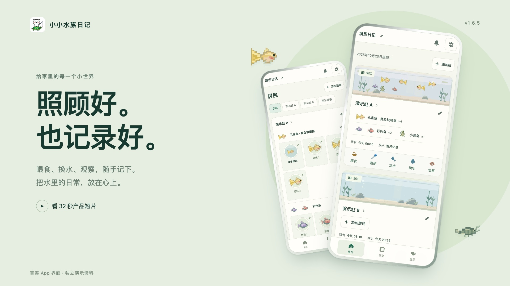
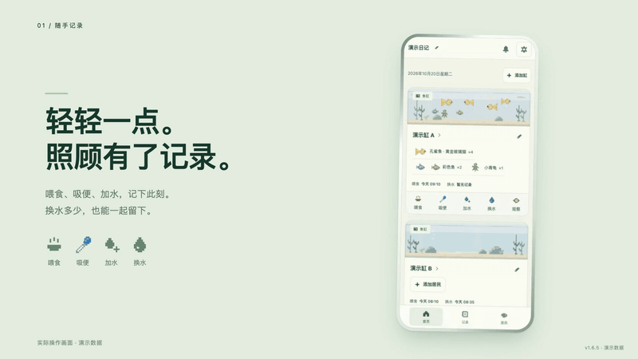
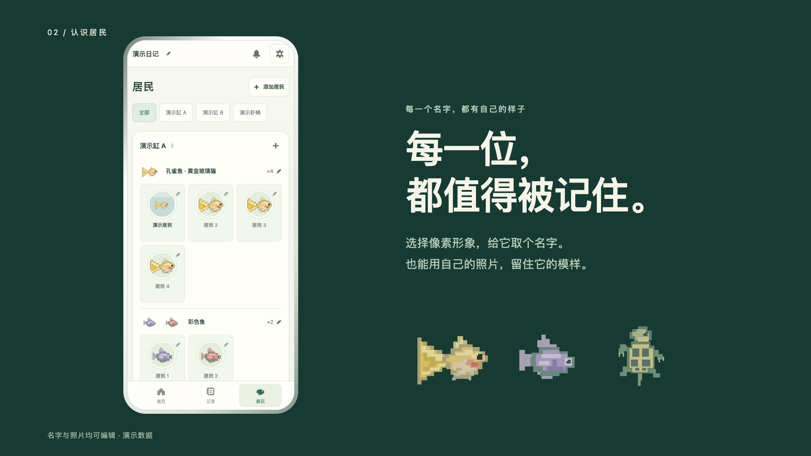
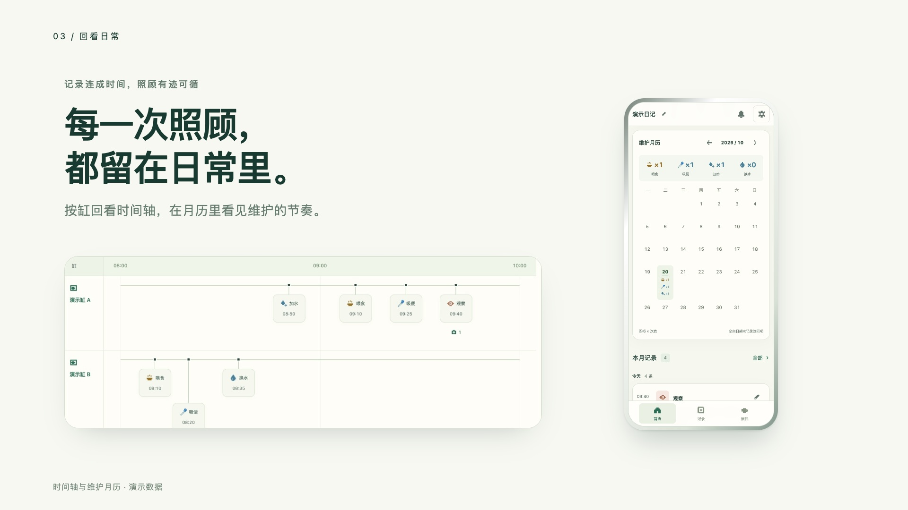
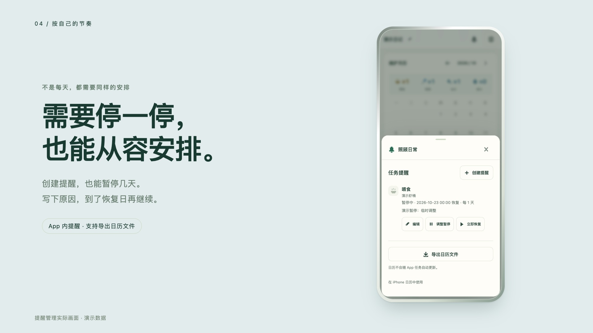
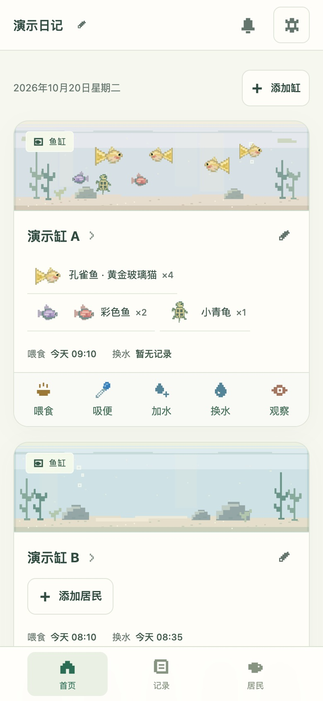
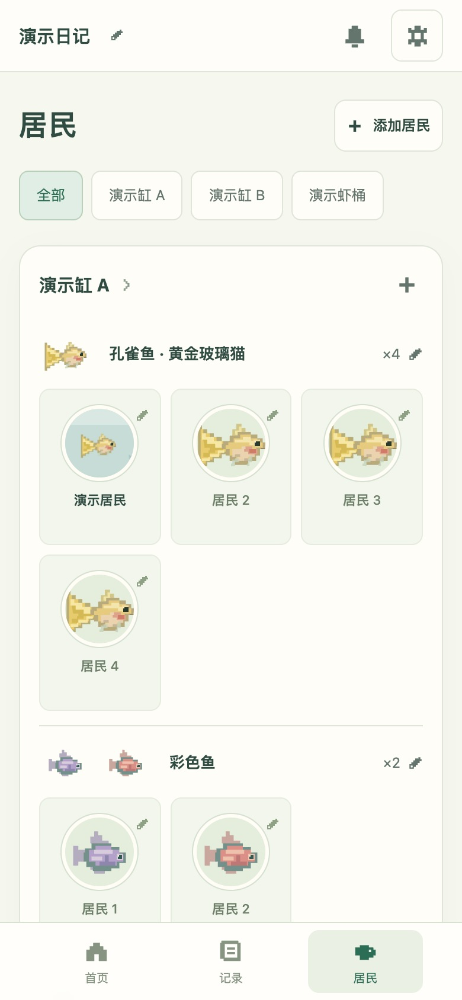
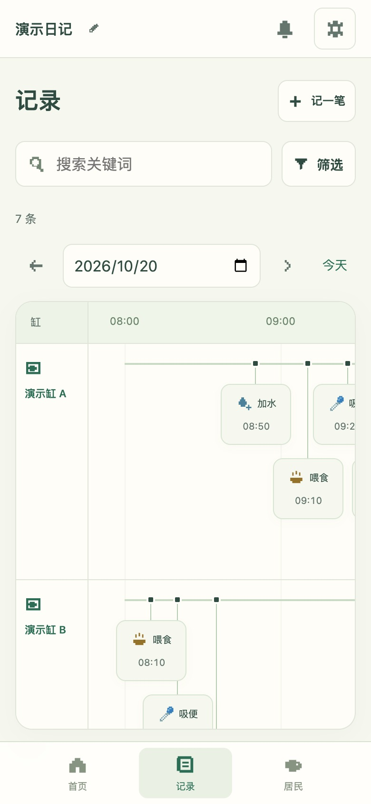
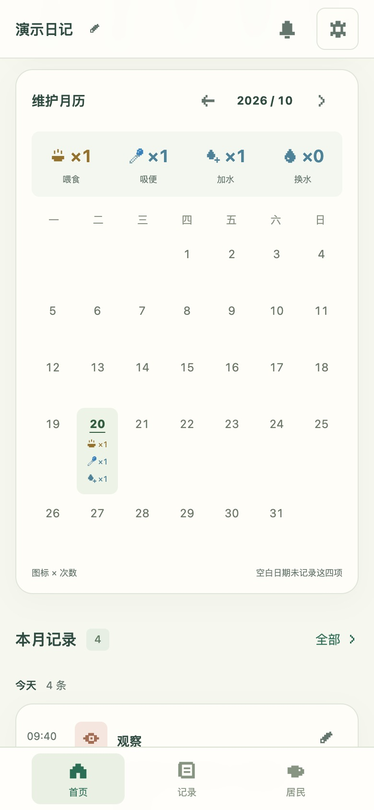

<h1 align="center">小小水族日记</h1>
<p align="center">给家里的每一个小世界，留一点日常。</p>

[](https://jiangyt1412.github.io/little-aqua-diary/intro.html#demo)

<p align="center"><a href="https://jiangyt1412.github.io/little-aqua-diary/"><strong>打开水族日记 ↗</strong></a>　 ·　 <a href="https://jiangyt1412.github.io/little-aqua-diary/intro.html#demo">观看 32 秒产品短片 ▶</a>　 ·　 <a href="https://jiangyt1412.github.io/little-aqua-diary/intro.html">浏览完整介绍</a></p>
<p align="center"><strong>Version 1.6.5</strong> · 2026-10-20<br>手机优先 · 本地保存 · 从空白开始</p>

## 把日常，养成喜欢。

[](https://jiangyt1412.github.io/little-aqua-diary/intro.html#demo)

**轻轻一点，照顾有了记录。** 喂食、吸便、加水记下此刻，换水多少也能一起留下。

[32 秒产品短片 · MP4](dist/media/demo-v1.6.5.mp4) · [完整实际操作 · MP4](dist/media/walkthrough-v1.6.5.mp4)

短片包含分镜、真实界面特写与原创配乐；完整录屏保留点击、输入、拖动和表单操作。GitHub 图片可点击前往播放器。

## 每一位，都值得被记住。



选择像素形象，取一个名字。也能用自己的照片留住它的模样，拖动、缩放或旋转裁剪头像。

## 每一次照顾，都留在日常里。



按缸对照时间轴，在月历里看见维护的节奏。搜索关键词，回看记录与观察照片。

<details>
<summary><strong>提醒暂停、完整手机截图与像素形象</strong></summary>



提醒在 App 内显示，另支持导出日历文件。暂停后，已经导入系统日历的内容需要另行修改。

<table>
<tr><td align="center"><br>首页</td><td align="center"><br>居民</td></tr>
<tr><td align="center"><br>共享时间轴</td><td align="center"><br>维护月历</td></tr>
<tr><td align="center"><br>头像取景</td><td align="center"><br>暂停与恢复</td></tr>
</table>


</details>

截图、录屏和短片均使用独立演示资料。名字与记录为示例，头像和照片附件为项目像素插画，不包含用户的个人资料。手机外框是展示排版，屏幕内容来自实际 App。首次打开仍是空白日记。

## 本次更新 · v1.6.5

- **项目介绍重做**：统一封面、图文叙事、界面特写和深浅绿色视觉；介绍页适配桌面和手机。
- **新增发布短片**：32 秒、1080p、30 fps，真实界面剪辑与原创配乐；提供中文字幕、播放状态和完整操作演示切换。
- 本次只更新项目展示与发布信息，日记功能、照片和备份格式沿用 v1.6.4。

[各版本的区别](docs/VERSIONS.md) · [完整更新记录](CHANGELOG.md) · [实际验收范围](验收记录.md)

## 从原网址迁移

原网址：[小小水族日记 · 原入口](https://little-aqua-diary-jyt.jiangy-t-10.chatgpt.site/)。

1. 在原网址打开右上角「管理与备份」，导出「备份（含照片）」。
2. 在新网址打开同一菜单，选择「恢复备份」。
3. 核对居民、记录和照片；恢复会替换新网址当前的数据，若已开始记录，先备份这份数据。

记录与名单保存在当前浏览器的 localStorage，照片保存在 IndexedDB。不同网址、浏览器和设备各自保存，不能自动同步。源码仓库不包含你实际使用时保存的记录与照片；清除网站数据会导致本地资料丢失，请保留浏览器之外的 JSON 备份。

## 运行与维护

网页是静态 HTML、CSS 和 JavaScript，无前端依赖或构建步骤。手机使用在线地址；本地运行需要 Python 3。

```sh
python3 -m http.server 4173 --bind 127.0.0.1 --directory dist # 在项目目录运行，打开 http://127.0.0.1:4173/
```

Node.js 22+ 可运行检查：

```sh
npm test # 验证数据、数量联动、旧备份与版本检查逻辑
npm run check:release # 核对版本、变更记录和当前版本的截图及视频
```

[完整使用说明](docs/USAGE.md) · [GitHub 部署与更新流程](docs/DEPLOYMENT.md) · [后续维护约定](AGENTS.md)

手机验证使用模拟视口，不等同于各品牌手机或 Safari 实机测试。本版提供主屏幕安装和缓存后的离线记录；没有云端同步或后台系统推送。

## 在 iPhone 使用

Safari 打开在线日记，点「共享 → 添加到主屏幕」，开启「作为网页 App 打开」再添加。先成功联网打开一次，缓存完成后可离线使用。设置里的安装提示也能查看步骤。[Apple 官方说明](https://support.apple.com/zh-cn/guide/iphone/iphea86e5236/ios)

提醒在 App 内显示。可导出日历文件，再作为附件从 Apple「邮件」打开导入日历；是否直接从下载文件导入，以设备实际界面为准。App 的暂停不会自动修改导入后的日历。[Apple 日历说明](https://support.apple.com/zh-cn/guide/iphone/ipha0d932e96/ios)

## 更新 App

右上角「管理与备份 → 检查更新」。发现新版后可查看更新内容，再点「更新到 v…」，保持联网直到自动重开。当前数据和照片保留。

从 v1.4.0 首次升级时，联网打开、等待缓存完成，再刷新或重开一次；菜单显示 v1.6.5 后即可使用新入口。无需卸载或清除网站数据。已安装主屏幕图标的系统刷新行为尚未在实体 iPhone 验证。
