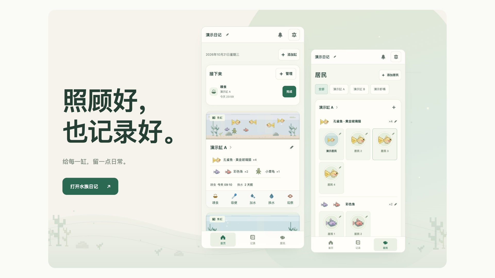
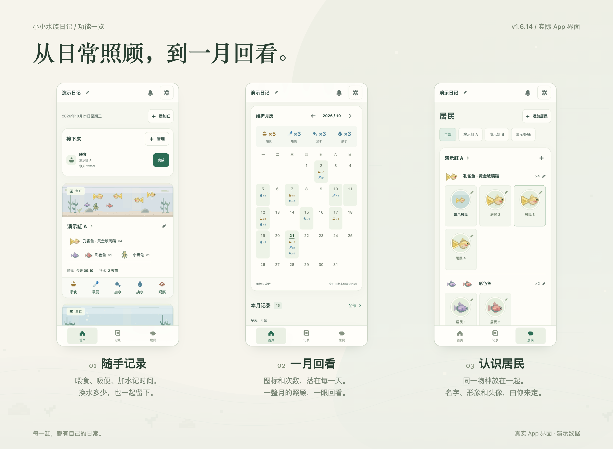
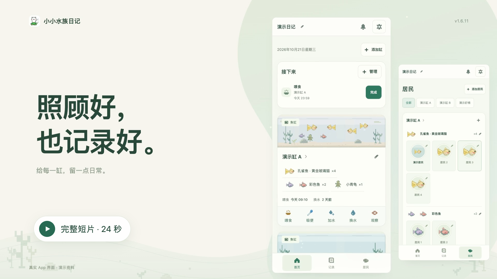
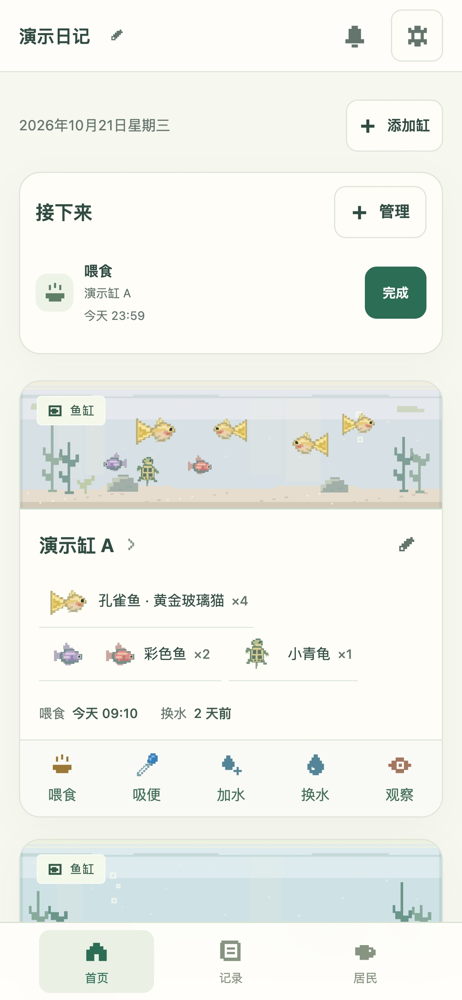
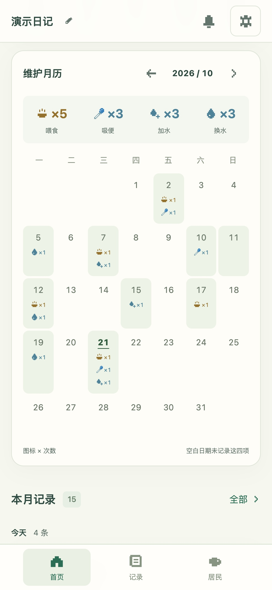

<h1 align="center">小小水族日记</h1>
<p align="center">照顾好，也记录好。</p>

[](https://jiangyt1412.github.io/little-aqua-diary/intro.html#overview)

<p align="center"><a href="https://jiangyt1412.github.io/little-aqua-diary/"><strong>打开日记 ↗</strong></a>　 ·　 <a href="https://jiangyt1412.github.io/little-aqua-diary/intro.html">图文介绍</a>　 ·　 <a href="https://jiangyt1412.github.io/little-aqua-diary/intro.html#demo">产品短片 ▶</a></p>
<p align="center"><strong>Version 1.6.14</strong> · 2026-10-21</p>

## 从日常照顾，到一月回看。

小小水族日记，把每个缸的照顾、居民和记录放在一起。从空白日记开始，缸、名字和居民都由你创建。



| 01 · 随手记录 | 02 · 一月回看 | 03 · 认识居民 |
| --- | --- | --- |
| 喂食、吸便、加水记时间，换水记录水量；从每个缸直接记下一次照顾。 | 喂食、吸便、加水、换水共用一张月历，用图标和次数回看每天的记录。 | 同一物种归在一起，不同颜色并排显示；为每一位居民取名、选形象或裁剪照片做头像。 |

## 细节，也能按你的方式来。

<table>
<tr><td align="center" width="50%"><h3>头像，留住它的模样。</h3><p>上传照片后拖动、缩放、旋转取景。<br>以后也可以重新裁剪。</p></td><td align="center" width="50%"><h3>提醒，按自己的节奏。</h3><p>暂停几天、指定恢复日期，或手动恢复。<br>也能记下这次暂停的原因。</p></td></tr>
</table>

记录还可以按缸分行，共用时间刻度回看。日记与照片保存在当前浏览器，完整备份可包含照片与头像取景副本。

## 完整产品短片 · 24 秒

[](https://jiangyt1412.github.io/little-aqua-diary/intro.html#demo)

点击封面进入播放器，播放完整短片（含声音），可暂停或拖动进度。

[观看 24 秒产品短片 · MP4](dist/media/demo-v1.6.14.mp4)

<details>
<summary><strong>更多实际界面与像素形象</strong></summary>

<table>
<tr><td align="center"><br>首页</td><td align="center"><br>居民</td></tr>
<tr><td align="center"><br>记录</td><td align="center"><br>维护月历</td></tr>
</table>


</details>

画面使用演示资料，名字和记录为示例，照片附件为项目像素插画。首次打开 App 为空白日记。图文布局参考用户提供的三屏示例，展示内容全部来自本项目。

## 本次更新 · v1.6.14

- 将 GitHub 的循环动图改为静态播放封面，明确区分预览图与完整24秒视频。
- 点击封面进入完整播放器，可暂停、拖动进度和打开字幕。
- 保留三屏图文介绍；完整视频仍沿用已确认的 v1.6.11 源片，App 操作与数据格式不变。

[所有版本的更新](CHANGELOG.md) · [版本号怎样区分](docs/VERSIONS.md) · [验收与设备范围](验收记录.md)

## 使用与备份

Safari 打开 [在线日记](https://jiangyt1412.github.io/little-aqua-diary/)，选择「共享 → 添加到主屏幕」。首次联网并完成缓存后可离线记录。[Apple 官方说明](https://support.apple.com/zh-cn/guide/iphone/iphea86e5236/ios)

日记与照片保存在当前浏览器，没有云同步。换设备、换网址或清除网站数据前，导出「备份（含照片）」；在新入口恢复备份会替换当前资料。旧网址的数据不会自动迁移。

提醒在 App 内显示，也可导出日历文件；App 中暂停或修改任务不会同步修改已经导入的日历。移动端验证采用模拟视口，实体 iPhone 的键盘、下载、照片与日历导入仍需实际设备复核。

更新入口为「管理与备份 → 检查更新」，查看更新内容后安装，保持联网直到自动重开。无需卸载或清除网站资料。

## 本地运行

无前端安装依赖，需要 Python 3。

```sh
python3 -m http.server 4173 --bind 127.0.0.1 --directory dist # 打开 http://127.0.0.1:4173/
```

```sh
npm test # 验证数据、联动、提醒、视口与版本规则
npm run check:release # 检查版本、说明、素材和部署资源
```

[完整使用说明](docs/USAGE.md) · [GitHub 部署](docs/DEPLOYMENT.md) · [维护约定](AGENTS.md)
