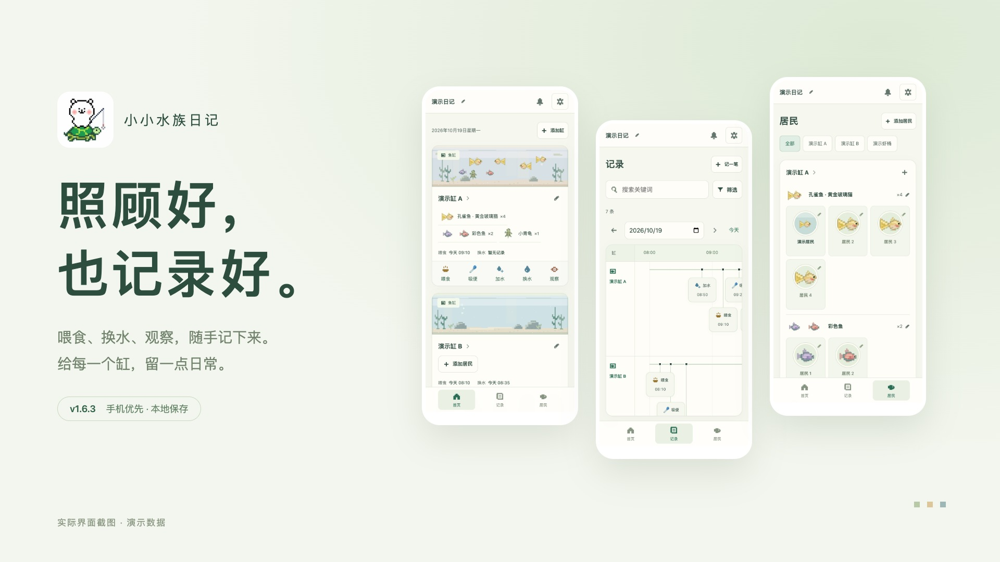
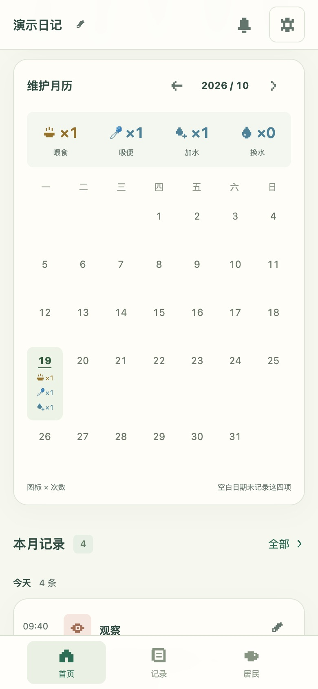
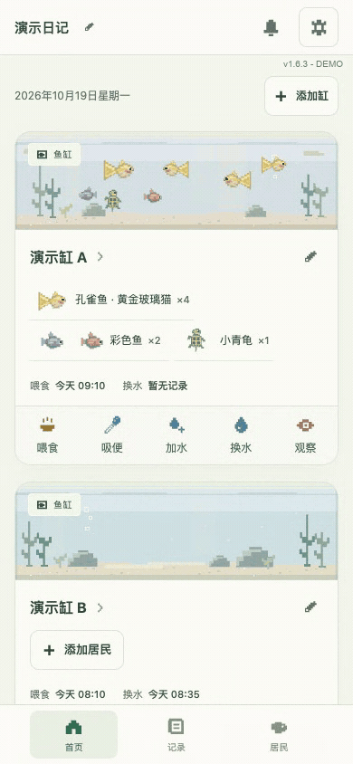
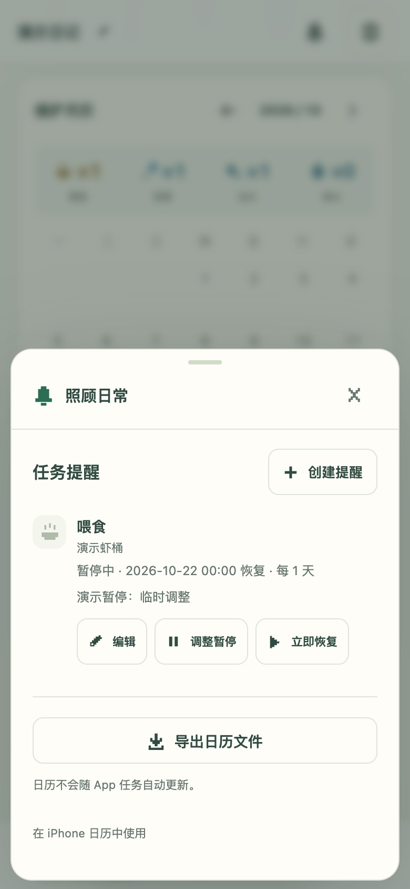

<p align="center"></p>

<h1 align="center">小小水族日记</h1>

<p align="center">照顾好，也记录好。<br>给家里的鱼缸、龟缸和虾桶，一本随手可记的日记。</p>

<p align="center"><strong>Version 1.6.3</strong> · 2026-10-19<br><a href="https://jiangyt1412.github.io/little-aqua-diary/">打开日记</a> · <a href="https://jiangyt1412.github.io/little-aqua-diary/intro.html#demo">观看实际操作视频</a> · <a href="CHANGELOG.md">更新记录</a></p>

[](https://jiangyt1412.github.io/little-aqua-diary/intro.html#demo)

## 本次更新 · v1.6.3

- **更新项目展示**：重新录制当前版本，集中展示最新截图、视频和鱼缸进出动图。
- **功能承接 v1.6.2**：孔雀鱼与其他物种的居民卡片等大，进入鱼缸连续滑入，支持左侧右滑返回。

本次更新发布资料与版本信息，日记功能和数据格式沿用 v1.6.2。

## 最新界面

<table>
  <tr>
    <td align="center"><br>首页 · 一键记录</td>
    <td align="center"><br>居民 · 卡片统一大小</td>
  </tr>
  <tr>
    <td align="center"><br>记录 · 按缸对照</td>
    <td align="center"><br>缸内 · 维护月历</td>
  </tr>
</table>

## 实际操作视频

[▶ 播放 v1.6.3 完整演示](https://jiangyt1412.github.io/little-aqua-diary/intro.html#demo) · [查看 MP4 文件](dist/media/demo-v1.6.3.mp4)

真实点击、输入与拖动，展示居民卡片、鱼缸过渡、右滑返回、记录搜索、照片、月历、头像裁剪、提醒暂停与恢复、版本检查。

<p align="center"><a href="https://jiangyt1412.github.io/little-aqua-diary/intro.html#demo"></a><br>鱼缸进出 · 实际录屏预览</p>

截图与录像均使用独立演示数据。演示记录和名字为示例，照片附件是原生像素插画，不含用户的个人照片。App 首次打开仍为空白日记。

## 每天常用的，放在手边

- 喂食、吸便、加水一点记录时间；换水可填升数或比例，观察可附照片。
- 自建鱼缸和居民，修改物种与数量；个体可命名、上传和裁剪头像。
- 按缸回看记录和月历，搜索关键词；提醒可暂停、填写原因并恢复。
- 在 App 内检查更新，导出包含记录、居民与照片的完整备份。

主界面保留首页、记录、居民三个入口。

<details>
<summary>更多界面与像素形象</summary>

<table><tr><td align="center"><br>头像 · 再次调整取景</td><td align="center"><br>提醒 · 暂停与恢复</td></tr></table>


黄金玻璃猫采用审核通过的 r2 原生 SVG，金黄圆腹、红鳃、黑眼与黄扇尾。海报直接使用 App 素材，不代表实际同缸或数量。

</details>

此前 v1.6.1 三轮审计的桌面、手机前后截图见 [产品审计](docs/AUDIT-v1.6.1.md)。本版实际验证见 [验收记录](验收记录.md)，版本区别与编号见 [版本一览](docs/VERSIONS.md)。

## 从原网址迁移

原网址：[小小水族日记 · 原入口](https://little-aqua-diary-jyt.jiangy-t-10.chatgpt.site/)。

1. 在原网址打开右上角「管理与备份」，导出「备份（含照片）」。
2. 在新网址打开同一菜单，选择「恢复备份」。
3. 核对居民、记录和照片；恢复会替换新网址当前的数据，若已开始记录，先备份这份数据。

记录与名单保存在当前浏览器的 localStorage，照片保存在 IndexedDB。不同网址、浏览器和设备各自保存，不能自动同步。源码仓库不包含你实际使用时保存的记录与照片；清除网站数据会导致本地资料丢失，请保留浏览器之外的 JSON 备份。

## 运行与维护

网页是静态 HTML、CSS 和 JavaScript，无前端依赖或构建步骤。手机使用在线地址；本地运行需要 Python 3。

```sh
python3 -m http.server 4173 --bind 127.0.0.1 --directory dist # 在项目目录运行，打开 http://127.0.0.1:4173/
```

Node.js 22+ 可运行检查：

```sh
npm test # 验证数据、数量联动、旧备份与版本检查逻辑
npm run check:release # 核对版本、变更记录和当前版本的截图及视频
```

[完整使用说明](docs/USAGE.md) · [GitHub 部署与更新流程](docs/DEPLOYMENT.md) · [后续维护约定](AGENTS.md)

手机验证使用模拟视口，不等同于各品牌手机或 Safari 实机测试。本版提供主屏幕安装和缓存后的离线记录；没有云端同步或后台系统推送。

## 在 iPhone 使用

Safari 打开在线日记，点「共享 → 添加到主屏幕」，开启「作为网页 App 打开」再添加。先成功联网打开一次，缓存完成后可离线使用。设置里的安装提示也能查看步骤。[Apple 官方说明](https://support.apple.com/zh-cn/guide/iphone/iphea86e5236/ios)

提醒在 App 内显示。可导出日历文件，再作为附件从 Apple「邮件」打开导入日历；是否直接从下载文件导入，以设备实际界面为准。App 的暂停不会自动修改导入后的日历。[Apple 日历说明](https://support.apple.com/zh-cn/guide/iphone/ipha0d932e96/ios)

## 更新 App

右上角「管理与备份 → 检查更新」。发现新版后可查看更新内容，再点「更新到 v…」，保持联网直到自动重开。当前数据和照片保留。

从 v1.4.0 首次升级时，联网打开、等待缓存完成，再刷新或重开一次；菜单显示 v1.6.3 后即可使用新入口。无需卸载或清除网站数据。已安装主屏幕图标的系统刷新行为尚未在实体 iPhone 验证。
