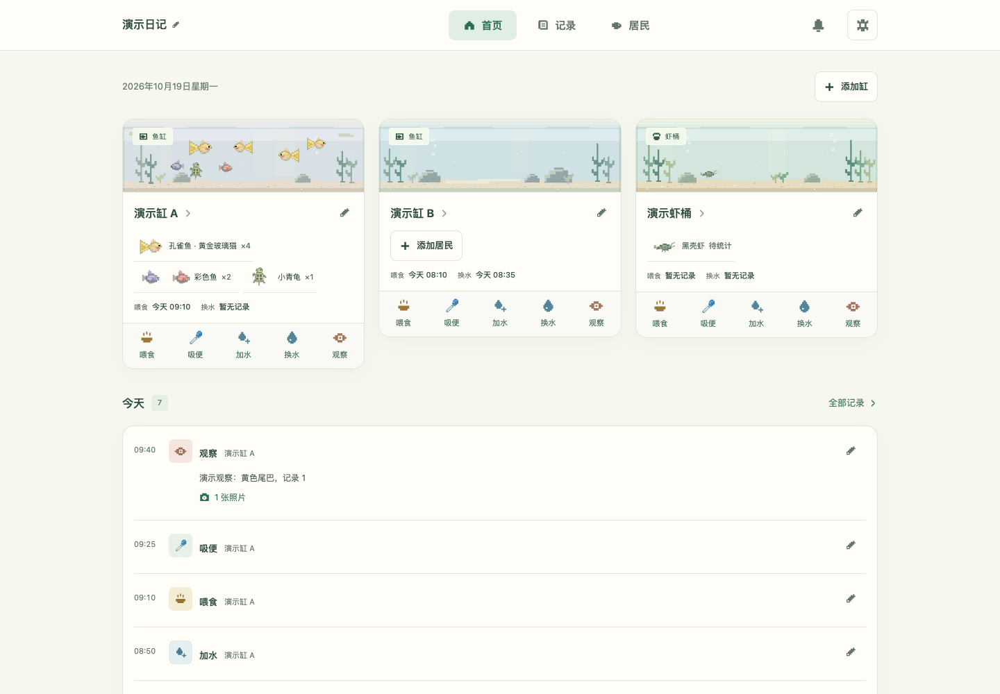
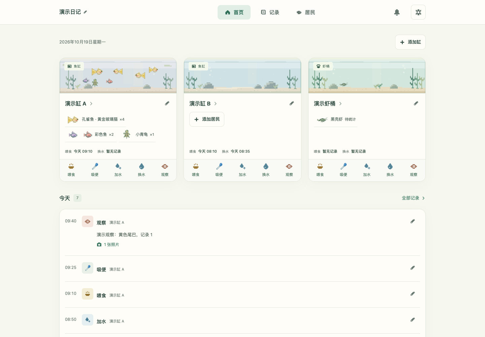
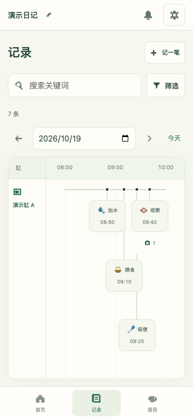
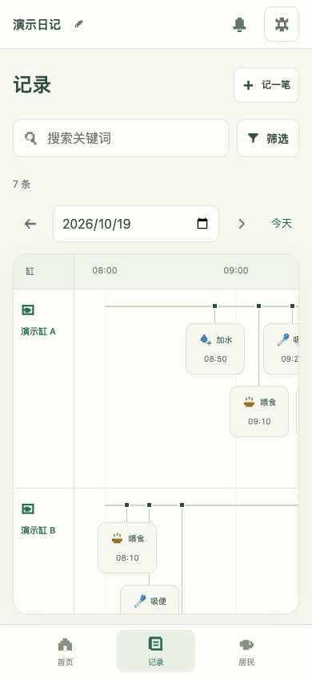

# v1.6.1 产品审计 · 2026-10-19

正式入口：[打开水族日记](https://jiangyt1412.github.io/little-aqua-diary/)。在「管理与备份 → 检查更新」核对当前版本。

优化前为已部署的 v1.6.0，基准提交 `1b1164e00c936adeb38232fe47d8e2ecd295f324`；优化后为 v1.6.1 最终源码。所有对比恢复同一份明确标记的演示备份，未读取实际用户浏览器里的日记或照片。

## 工具与限制

使用现有代码、终端、Chrome 浏览器、触屏事件、截图、录屏、GitHub 与 Pages。没有安装依赖。本轮找不到可启动的 WebKit，也没有实体 iPhone；不把 Chrome 手机视口当成 Safari 真机。应用内浏览器打开超时后使用独立 Chrome 直接访问真实站点。

## 第一轮：流程

按真实控件完成空白建缸、居民创建、命名裁剪、快捷记录、撤销、换水、观察照片、十二类记录、数量联动、搜索筛选、日期、提醒、日历导出、备份恢复、重置取消、月历、键盘与离线使用。

确认并修复：

- 空白日记从「记一笔」开始，建好首缸后原流程中断；现在继续选择记录。居民与提醒入口也保留继续创建。
- 提醒保存、暂停、恢复和完成会退出整个管理窗口；现在留在原任务列表，子窗口有返回入口。
- 从提醒完成换水直接保存空水量；现在先填写升数或比例。
- 键盘「跳到主要内容」误改路由并跳回首页；现在聚焦当前页主体。
- 代码核对发现编辑完成记录未保留原任务引用；修复后实际编辑验证关联保留。

本地最终版本重新跑完 15 组核心流程，全部通过，包括离线重开保存和含照片恢复。初审日志里的隐藏控件、重复选择器及关闭过渡等待问题均与产品问题分别记录；没有把测试脚本失误计入产品缺陷。

## 第二轮：视觉与 UX

- 桌面同行鱼缸的最近维护和快捷操作统一对齐。
- 统一控件圆角、记录字号和行内位置；暂停状态保持文字可读。
- 时间轴保留按记录范围自动缩放；密集记录有适量横向空间，只有带照片的轨道预留照片高度，减少纵向堆叠。窄屏图表可横滑，整页不横向溢出。
- Chrome 在 320、375、390、430、768、1440 px 检查 108 个页面／表单组合、666 项控件边界；十二种记录表单、建缸和提醒均通过。常用日期、时间、输入和按钮不越界，触控高度至少 44 px。

### 桌面 · 同一演示资料，1440 × 1000

| v1.6.0 优化前 | v1.6.1 优化后 |
| --- | --- |
|  |  |

### 手机 · 同一演示资料，390 × 844

| v1.6.0 优化前 | v1.6.1 优化后 |
| --- | --- |
|  |  |

## 第三轮：动效与状态

保留原生下拉菜单并实际选择、修改、保存；原生展开项增加短淡入，弹窗开关和窗口内切换保留遮罩。检查标签页预览、短拖回弹、详情左缘返回及原位置恢复。

增加加载标识、保存中文字和防重复操作；成功提示平滑出现消失，校验错误轻淡入，照片加载有过渡。模拟网络错误能恢复重试，不停留在禁用状态；系统减少动态效果时关闭这些动画，状态文字仍可读。网络、模块与存储延迟仅在隔离测试中模拟。

六种宽度密集事件无卡片重叠或越出时间列；快速关闭再开、Escape、头像取消、短屏、减少动态效果、CDP 触摸与鼠标混用通过。原始 JSON 在取消和只读检查中保持一致。

## 发布验证

- 81 项 Node 测试通过；JavaScript 语法与发布版本检查通过后发布。
- 从实际 v1.6.0 源码升级：缺少 motion.js 时保留旧版、原始 JSON、七条记录、头像、完整取景副本与无关缓存；恢复资源后重试成功并自动重开 v1.6.1。旧头像仍可再次裁剪，旧长标题不截断。
- 当前版 47.53 秒、780 × 1688 操作 MP4 播放通过，简介四种宽度和全部图片解码通过。视频新增展示提醒暂停、原因、恢复、完成和换水量。
- GitHub Pages 部署与线上实际资源在上传后单独核对。源码版本、服务器版本、手机当前缓存版本分别判断。

## 尚未验证／仍有限制

没有 iPhone 真机和可启动的 WebKit，未验证 Safari 系统边缘手势、软键盘、安全区、主屏幕旧图标刷新及原生日历通知；需在真实设备检查。提醒仍为 App 内提示，日历导出是快照。没有云同步，换设备需用含照片备份迁移。数据量特别大时的存储配额与长期性能没有穷尽测试。
